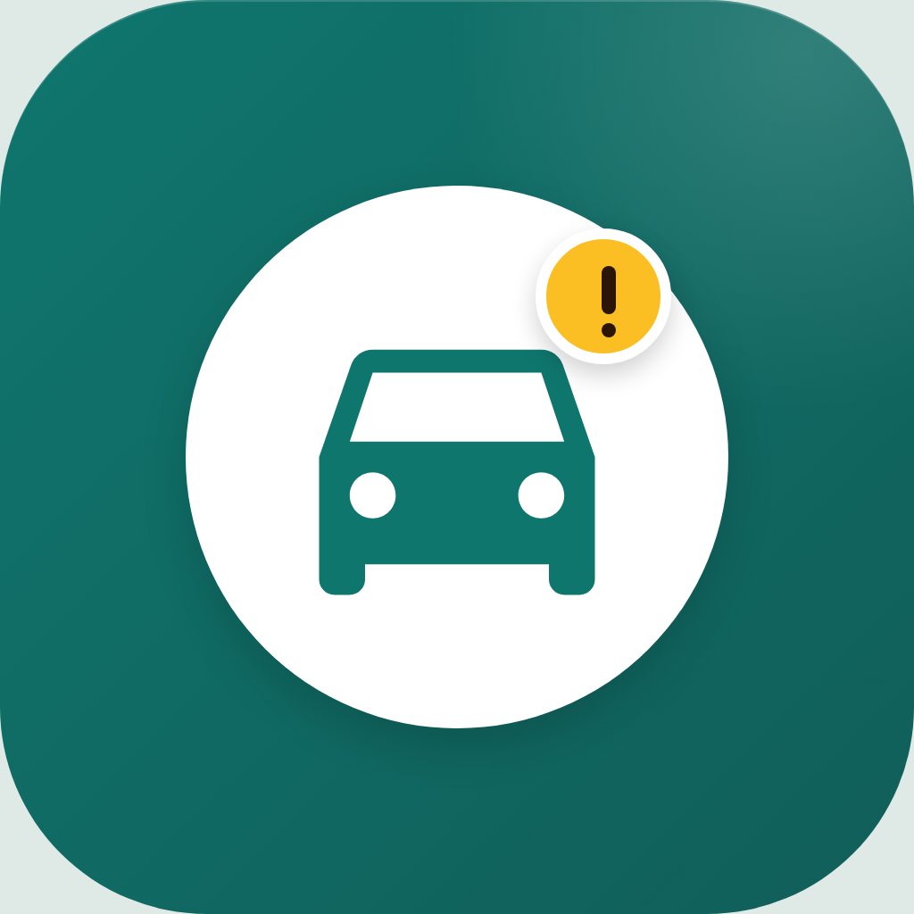
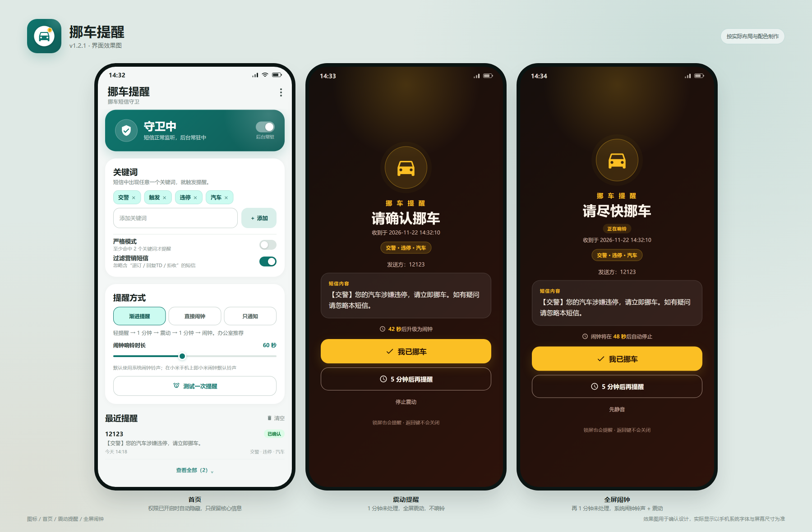

<p align="center">
  
</p>

<h1 align="center">挪车提醒 · ParkingAlert</h1>

<p align="center">
  Android 短信关键词监听与三段式挪车提醒工具：轻提醒 → 震动 → 闹钟。
</p>

<p align="center">
  <a href="https://github.com/Hikaru275/ParkingAlert/releases">下载 APK</a> ·
  <a href="#界面预览">界面预览</a> ·
  <a href="#从源码构建">从源码构建</a> ·
  <a href="CHANGELOG.md">更新日志</a> ·
  <a href="#许可证">License</a>
</p>

<p align="center">
  
  
  
  
  <a href="https://github.com/Hikaru275/ParkingAlert/releases"></a>
</p>

> **当前版本**：v1.2.1 · versionCode 5  
> **包名**：`com.hikaru.parkingalert`  
> **仓库只包含源码与预览图，APK 通过 GitHub Releases 发布。**

---

## 简介

**ParkingAlert / 挪车提醒** 是一个完全本地运行的 Android 违停短信提醒工具。它监听系统短信广播，按用户自定义关键词匹配违停、挪车类通知，并在命中后按“轻提醒 → 震动 → 闹钟”的顺序逐步升级，避免在办公室被突然的大音量打扰，同时降低漏报概率。

- 不申请 `INTERNET` 权限
- 不上传短信、关键词或提醒记录
- 不依赖账号、云服务或第三方推送
- 默认使用手机系统的闹钟铃声；在小米手机上即 MIUI 默认闹钟铃声

## 界面预览



[首页大图](docs/preview/home.png) · [守卫关闭状态](docs/preview/home-off.png) · [震动提醒大图](docs/preview/vibration.png) · [全屏闹钟大图](docs/preview/alarm.png) · [图标](docs/preview/icon.png)

> 预览图按实际布局、配色和文案制作；实际显示会受手机系统字体、屏幕尺寸和厂商样式影响。

## 核心功能

| 功能 | 说明 |
|---|---|
| 后台短信监听 | 通过系统 `SMS_RECEIVED` 广播接收短信，App 未打开时也可触发；支持多段短信拼接 |
| 自定义关键词 | 添加、删除、恢复预置关键词；预置为 `交警 / 触发 / 违停 / 汽车` |
| 智能降噪 | 默认忽略含“退订 / 回复TD / 拒收”等标记的营销短信；可选严格模式（至少命中 2 个关键词） |
| 三段式提醒 | 轻提醒 → 60 秒 → 震动 → 60 秒 → 全屏闹钟 |
| 确认与延后 | 支持“我已挪车”“停止震动/先静音”“5 分钟后再提醒” |
| 系统闹钟铃声 | 读取 `RingtoneManager.TYPE_ALARM`，跟随系统闹钟设置；失败时回退内置警报音 |
| 精简首页 | 已开启的权限不再显示；全部开启后权限卡片自动隐藏 |
| 本地历史 | 默认显示最近 3 条，可展开全部；支持查看、复制、清空 |
| 后台常驻 | 可选的 `specialUse` 前台服务 + 低优先级常驻通知；关闭后首页切为“后台常驻已关闭”状态 |
| 自启动引导 | 小米/华为/OPPO/vivo 等机型提供自启动设置入口，并支持手动确认“已开启” |
| 每日权限检查 | 每天 09:00 / 18:00 检查权限；缺失时发送权限提醒通知 |
| 无网络权限 | 不申请 `INTERNET`，无统计、广告、崩溃上报 SDK |

## 提醒流程

```text
收到短信
  │
  ├─ 未命中关键词 / 营销短信 → 忽略
  │
  └─ 命中关键词
        │
        ├─ 第 1 段：轻提醒（约 0 秒）
        │    高优先级横幅 + 2.8 秒轻柔提示音 + 一次震动
        │    不抢屏
        │
        ├─ 第 2 段：震动提醒（60 秒后）
        │    全屏提醒页
        │    约 12 秒强震动，不响铃
        │
        └─ 第 3 段：全屏闹钟（再 60 秒后）
             系统闹钟铃声 + 震动
             音量从 20% 渐强，最长响 60 秒
                   ├─ 我已挪车       → 停止并记录
                   ├─ 停止震动/静音   → 停止当前声音或震动
                   └─ 5 分钟后再提醒 → 再次精确闹钟
```

也可在设置中切换为：

- **直接闹钟**：命中后立即全屏响铃，最可靠但最打扰。
- **只通知**：只响一次提示音，不震动、不升级，适合会议等场景。

## 安装

### 从 Releases 下载

1. 打开 [Releases](https://github.com/Hikaru275/ParkingAlert/releases)。
2. 下载最新版本的 `ParkingAlert-vX.Y.Z.apk`。
3. 在手机上允许浏览器或文件管理器“安装未知应用”。

> 本应用不通过 Google Play 分发。Google Play 对 `RECEIVE_SMS` 权限有严格限制，本项目定位为个人侧载工具。

### 首次设置

打开 App 后，只有**尚未开启**的权限会显示在“完善运行设置”卡片中。建议按顺序开启：

1. **短信读取**：必需，否则无法接收违停短信。
2. **通知权限**：必需，横幅、震动和全屏闹钟都依赖它。
3. **精确闹钟**：建议开启，保证 60 秒后的升级准时触发。
4. **全屏提醒**：建议开启，锁屏时才能自动弹出提醒页。
5. **电池优化白名单**：建议开启，降低息屏后被冻结的概率。
6. **自启动 / 后台弹出**：小米、华为、OPPO、vivo 等机型需要在系统设置中手动允许，入口在右上角菜单 →“设置后台权限”；从系统设置返回后，点“已开启”完成确认。

完成后点“测试一次提醒”。默认完整流程约 2 分钟；想快速验证闹钟，可临时切换到“直接闹钟”。

### 厂商后台设置

| 品牌 | 建议设置 |
|---|---|
| 小米 / 红米 | 自启动、后台弹出界面、锁屏显示；省电策略设为“无限制” |
| 华为 / 荣耀 | 应用启动管理 → 手动管理，允许自启动、关联启动、后台活动 |
| OPPO / 一加 / realme | 自启动、允许后台运行；电池 → 不优化 |
| vivo / iQOO | 自启动、后台高耗电；电池 → 不优化 |
| 三星 | 电池 → 后台使用限制 → 不受限制 |
| 其他 | 允许自启动、后台运行，并加入电池优化白名单 |

设置完成后，建议在最近任务列表中锁定“挪车提醒”，避免清理后台时被一并清除。

## 使用说明

### 关键词

- 输入关键词后点“添加”；点标签上的 `×` 删除。
- 至少保留一个关键词。
- “汽车”是宽泛词，建议保持“过滤营销短信”开启；误报仍多时再开启“严格模式”。
- 严格模式按“不同关键词命中数 ≥ 2”判断，重复关键词只算一个。

### 提醒方式

- **渐进提醒（默认）**：轻提醒 → 1 分钟 → 震动 → 1 分钟 → 闹钟。
- **直接闹钟**：命中后立即响铃，适合地下车库、会议室外等必须马上知道的场景。
- **只通知**：只发一次提示音，适合暂时不方便被打扰的场景。

### 历史记录

- 默认显示最近 3 条，点“查看全部”展开；最多保留 50 条。
- 点任意一条查看完整短信，可复制正文。
- “清空”会删除全部本地记录和短信内容。
- 关闭“保存短信记录”后，新提醒不再写入历史。

### 后台常驻

- 默认开启，会显示一条低优先级常驻通知“挪车提醒守卫中”。
- 关闭后，首页 Hero 会从青绿色切换为棕褐色，标题变为“后台常驻已关闭”，开关旁提示“点击开启”。
- 关闭后台常驻后，短信仍会由系统广播送达（App 未被强行停止时）；但手机更容易清理后台，提醒可能变慢或漏掉。
- 若不希望常驻通知，可在系统通知设置中将“后台常驻”频道设为静默或最低优先级。

### 每日权限检查

- App 每天 **09:00** 和 **18:00** 本地检查一次权限。
- 缺少短信、通知、精确闹钟、全屏提醒、电池白名单或自启动确认时，会发送“挪车提醒需要设置”通知。
- 全部满足后不会打扰；检查时间会随系统时区变化重新计算。

## 权限说明

| 权限 | 用途 | 是否必需 |
|---|---|---|
| `RECEIVE_SMS` | 接收短信并匹配关键词 | 必需 |
| `POST_NOTIFICATIONS` | 显示横幅、通知、震动和全屏闹钟 | Android 13+ 必需 |
| `SCHEDULE_EXACT_ALARM` | 60 秒后准时升级为震动/闹钟 | 建议 |
| `USE_FULL_SCREEN_INTENT` | 锁屏时弹出全屏提醒页 | 建议 |
| `VIBRATE` | 震动阶段和闹钟震动 | 可选 |
| `WAKE_LOCK` | 响铃期间保持 CPU 运行 | 内部使用 |
| `RECEIVE_BOOT_COMPLETED` | 重启后恢复未处理提醒和后台常驻 | 建议 |
| `FOREGROUND_SERVICE` 系列 | 震动/闹钟播放、后台常驻 | 内部使用 |
| `REQUEST_IGNORE_BATTERY_OPTIMIZATIONS` | 引导加入电池白名单 | 建议 |
| `ACCESS_NOTIFICATION_POLICY` | 可选的免打扰穿透尝试 | 可选 |

**未申请 `INTERNET` 权限。**

> “自启动 / 后台弹出”不是 Android 标准权限，系统没有公开接口读取开关状态。App 会引导你前往厂商设置，返回后由你确认“已开启”，确认结果只保存在本机。

## 隐私与安全

- 短信原文、命中关键词、提醒记录和设置均保存在 App 私有目录的 `SharedPreferences` 中。
- `backup_rules.xml` 与 `data_extraction_rules.xml` 已排除该文件，避免短信内容进入云备份或设备迁移。
- 不集成统计、广告、崩溃上报等 SDK。
- 通知频道使用 `VISIBILITY_PUBLIC`，锁屏可能显示短信正文；可在系统通知设置中改为“隐藏内容”。
- 仓库不包含签名密钥、`keystore.properties`、`local.properties` 或 APK 二进制。

## 兼容性

- 最低 Android 8.0（API 26）
- 目标 Android 15（targetSdk 35）
- 使用 Kotlin 2.0.21、AGP 8.7.3、Gradle 8.9
- 已在编译、Lint、单元测试和布局冒烟测试层面验证；尚未连接实体 Android 手机做全链路安装测试

**重要**：不同厂商的后台策略差异很大。请在目标手机上实际测试短信接收、锁屏弹出、震动和闹钟铃声，并根据“厂商后台设置”完成白名单配置。

## 从源码构建

### 环境

- JDK 17
- Android SDK Platform 35
- Android SDK Build-Tools 35.0.0
- Gradle 8.9（工程自带 wrapper）

### 构建

```bash
# 1. 配置 SDK 路径
# local.properties
sdk.dir=/path/to/Android/Sdk

# 2. Debug 构建
./gradlew assembleDebug

# 3. 单元测试 + 布局测试
./gradlew testDebugUnitTest

# 4. Release 构建
./gradlew assembleRelease
```

Release 构建需要一个本地签名配置。仓库不包含签名文件，请自行创建 `keystore.properties`：

```properties
storeFile=keystore/my-release.jks
storePassword=your-store-password
keyAlias=my-alias
keyPassword=your-key-password
```

Gradle wrapper 使用华为云镜像分发地址，便于国内网络构建。如使用海外网络，可将 `gradle/wrapper/gradle-wrapper.properties` 中的 `distributionUrl` 改为 Gradle 官方地址。

## 项目结构

```text
ParkingAlert/
├─ app/src/main/java/com/hikaru/parkingalert/
│  ├─ alert/        # 状态机、震动/闹钟前台服务、全屏提醒页、精确闹钟
│  ├─ data/         # 数据模型、SharedPreferences 持久化
│  ├─ service/      # 后台常驻前台服务
│  ├─ sms/          # SMS 广播接收器、关键词匹配
│  ├─ ui/           # 主界面
│  └─ util/         # 通知、权限、厂商设置、时间格式化
├─ app/src/main/res/        # 布局、主题、图标、提示音
├─ app/src/test/            # 关键词匹配 + Robolectric 布局测试
├─ docs/DESIGN.md           # 三段提醒状态机与设计说明
├─ docs/preview/            # 界面效果图
├─ keystore.properties      # 本地签名配置（.gitignore 排除）
└─ gradle/                  # Gradle wrapper
```

## 测试

当前仓库包含：

- **9 个** `KeywordMatcher` 单元测试：关键词命中、严格模式、营销过滤、全角/空格/零宽字符归一化、英文大小写、重复关键词、空列表、真实测试文案。
- **2 个** Robolectric 布局冒烟测试：主界面 inflate + 分段按钮选中、提醒页 inflate。
- **4 个** `PermissionCheckTimes` 测试：覆盖 09:00 / 18:00 前后各时间点的下一次检查时间。

已验证：

```text
tests = 15, failures = 0
lintDebug = 0 errors
assembleRelease = success
```

## 已知限制

1. **无法保证 100% 送达**。系统省电策略、安全软件拦截、强行停止、闹钟音量为 0、通知频道被关闭都可能导致漏报。
2. **不是默认短信应用**，不适合直接上架 Google Play。
3. **强行停止后不会自动恢复**，需手动打开 App。
4. **精确闹钟 / 全屏提醒可能被系统拒绝**；未授权时会退化为普通通知。
5. **免打扰穿透不保证生效**；即使授予勿扰权限，部分系统仍会拦截闹钟声道。
6. **没有真正的电话提醒**。Android 不允许三方 App 自动拨号后向用户播放语音；模拟来电界面也未纳入本版本。
7. **每日检查依赖系统闹钟和通知**。精确闹钟被拒绝、通知被关闭或系统深度休眠时，09:00 / 18:00 的检查可能延迟或不可见。
8. **本次构建未连接实体手机测试**；安装后请先运行“测试一次提醒”，再用真实短信验证。

## 路线图

- [ ] 模拟来电式强提醒（可选，默认关闭）
- [ ] 发送方白名单/黑名单
- [ ] 免打扰时段 / 会议模式
- [ ] 关键词分组与正则规则
- [ ] 通知内快捷回复“已挪车”给发送方（需要默认短信应用权限）
- [ ] 英文界面 / 多语言
- [ ] GitHub Actions 自动构建与 Release

## 贡献

欢迎提交 Issue 或 Pull Request。

- Bug 反馈请附上 Android 版本、厂商/机型、复现步骤和相关日志（注意隐藏手机号和短信正文）。
- 提交代码前请至少运行：

```bash
./gradlew testDebugUnitTest lintDebug
```

- 请勿在 Issue/PR 中提交真实短信内容、手机号、签名文件或 token。

## 许可证

本项目基于 [MIT License](LICENSE) 开源。

```text
MIT License
Copyright (c) 2026 Hikaru275
```

## 免责声明

这是一个辅助提醒工具，不能替代你对车辆和停车状态的关注。因漏报、误报、系统限制或厂商策略造成的任何后果，作者不承担责任。

---

<p align="center">
  Made for Android · Local-first · No tracking
</p>
